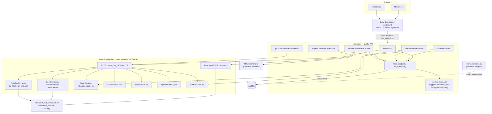

# Claims Assist — local extraction lab

Run and test the Claims Assist document-extraction code from JupyterLab or `pytest`.

## Quick start

```bash
python -m venv .venv
source .venv/bin/activate          # Windows: .venv\Scripts\activate
pip install -r requirements.txt

jupyter lab notebooks/01_claims_extraction_lab.ipynb   # interactive lab
pytest                                                  # automated checks
python make_samples.py                                  # (re)generate samples/ on its own
```

## How it works

`src/app.py` exposes six extraction functions (`extractText`, `extractFormattedPDFText`, `excelExtractText`, `extractEmbeddedText`, `getSupportedFileExtensions`, `inspectDocumentProtection`). Each takes a payload whose `path` is a local file; the extension is taken from the payload or, failing that, sniffed from the file signature (`resolve_extension`).

`local_harness.py` dispatches them by name (`h.call("extractText", {"path": ..., "file_extension": ".docx"})`) and offers `h.run("extractText", "fnol_form.docx")`, which also resolves bare names under `samples/`.



1. A caller (notebook or test) names a function and passes a payload dict to `local_harness.py`, which builds the matching `Payload` or `FormattedPDFPayload`.
2. The `app.py` function calls `load_doc`, which reads the file into a `DocumentContent` (bytes plus a decoded `.text` view) and resolves its extension.
3. The function hands the `DocumentContent` to an extractor from `text_extract.py` (`extractText` picks it through `EXTENSION_TO_EXTRACTOR`; the others use a fixed one), which returns a list of strings: pages, slides or sheets.
4. `inspectDocumentProtection` skips the extractors and asks `fitz` (PDF) or `msoffcrypto` (Office) whether the file is encrypted.

## Layout

```
src/                  extraction modules
local_harness.py      call()/run() dispatch helpers
make_samples.py       generates ~25 sample documents into samples/
notebooks/            01_claims_extraction_lab.ipynb
tests/                pytest suite (83 tests)
```

## Sample documents

`make_samples.py` generates a small, coherent fictional insurer's Q1 2026 claims dataset (8 claims, CL-10421 …) in many formats, so every extractor works on something realistic:

| Kind | Files |
|---|---|
| Text | `claim_notes.txt`, `claim_report.html`, `claim_feed.xml`, `adjuster_notes.md` (HTML comment + base64 signature image + table), `settlement_letter.rtf`, `claims_register.csv` |
| Word | `fnol_form.docx` / `.docm` (merged cells, bullets, page break), `fnol_no_extension` |
| Excel | `loss_run.xlsx` (title, 3 tables incl. side-by-side + merged cell, cached formulas, chart, text box, comment), `claims_workbook.xlsx` (4 sheets incl. a hidden one), `legacy_register.xls`, `loss_run_misnamed.xls` |
| Other | `claims_review.pptx` (table, chart, notes, grouped shapes), `loss_summary.pdf` (3 pages: headings, bold/italic, table, bullets, footer), `scanned_receipt.pdf` (image only), `loss_summary_padded.pdf`, `claim_package.zip`, `damage_photo.png` |
| Encrypted (password `secret`) | `loss_summary_encrypted.pdf`, `fnol_form_encrypted.docx`, `loss_run_encrypted.xlsx` |

## What it demonstrates

* **Text extraction**: txt, html, xml (returned as raw markup), md, csv, rtf, docx, docm, pptx, pdf (`extractText`).
* **Excel**: single sheet (`extractText`), per-sheet (`excelExtractText`), hidden sheets (still read), `.xls` / `.xlsx` / misnamed files (engine chosen from the file signature), rounding, pipe escaping, 2000×200 caps — and the current limitations (generated `0 1 2` headers, side-by-side tables flattened, merged cells only on first row, formulas without cached values come out blank, charts/text boxes/comments ignored).
* **Formatted PDF** (`extractFormattedPDFText`): headings, bold/italic, indentation, per-call tuning; table cells come out one per line. Scanned (image-only) PDFs give blank text — no OCR.
* **Password protection — detection only** (`inspectDocumentProtection`): encrypted PDF, `.docx`, `.xlsx`. Nothing is decrypted, so extraction from encrypted files fails.
* **Extension / signature detection**: images, PDFs with leading junk, extension-less files, ZIP-based Office files, archives (`.zip`/`.gz`/`.rar`/`.7z` are recognised but **not extractable**). All OLE2 files (legacy `.xls`, encrypted Office) are reported as `.doc` when no extension is supplied.
* **Loading**: missing files raise `FileNotFoundError`; a supplied extension wins over signature sniffing.

## Notes on the code under test

The unreachable code identified earlier was removed from `src/`: the OLE2 branch of `get_extension_from_file_signature` (it called a non-existent `olefile` method) and the `EMLExtractor` / `MSGExtractor` classes (never registered, no `self`), plus the imports they needed.

## Not covered

`.xlsb`, `.msg`, legacy `.doc` / `.ppt` samples can't be generated here — drop your own into `samples/` (or set `MY_FILE` in the last notebook cell). OCR/image content is out of scope.
